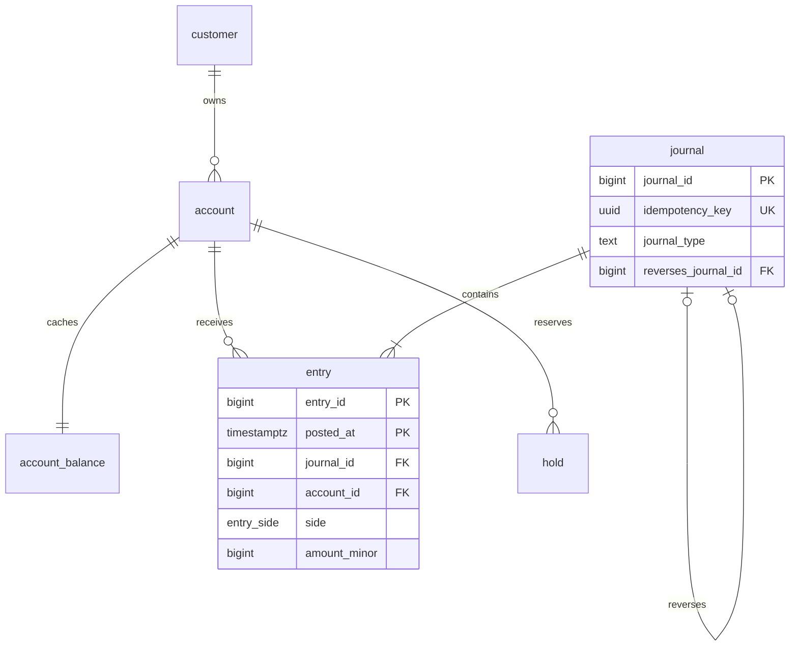

# Ledger Core


A double-entry banking ledger built entirely in PostgreSQL. The database itself guarantees that money cannot be created, lost, spent twice or silently edited, even when many sessions write at the same time.

## At a glance

| Metric | Value |
| --- | --- |
| Seeded journals | 23,705 |
| Seeded ledger entries | 53,144 |
| Behavioural tests | 63 |
| Concurrent transfers in the load test | 8,000 across 16 sessions |
| Failed transactions or deadlocks in the load test | 0 |
| Fraud detectors | 4 |

All data is synthetic and generated deterministically.

## Data model



## Guarantees and how they are enforced

| Guarantee | Mechanism |
| --- | --- |
| Debits equal credits in every currency | Deferred constraint trigger checked at commit |
| History cannot be changed | Triggers block `UPDATE`, `DELETE` and `TRUNCATE` on journals and entries |
| Corrections keep the audit trail | Compensating reversal journals, limited to one per original |
| Retries never pay twice | Unique idempotency keys plus a request fingerprint |
| No double spending | Row locks and a balance check inside the posting transaction |
| No deadlocks between opposing transfers | Accounts are always locked in ascending id order |
| Currencies cannot be mixed | Composite foreign key on account and currency |
| Exact arithmetic | Amounts stored as `bigint` minor units |

## Features

- **Payments:** deposits, withdrawals, transfers with fees and overdraft limits.
- **Foreign exchange:** four-leg postings through FX position accounts keep each currency balanced.
- **Card-style holds:** authorise, partially capture, release and expire, using `FOR UPDATE SKIP LOCKED` for the expiry job.
- **Partitioning:** entries are range-partitioned by month.
- **Least privilege:** applications can only call the API, auditors are read-only, and row-level security limits customers to their own data.
- **Controls:** trial balance, balance drift and hold drift views.

## Fraud detection

| Detector | Pattern | SQL technique |
| --- | --- | --- |
| `detect_velocity` | Many outgoing payments in minutes | `RANGE` window over time |
| `detect_structuring` | Cash deposits just below the reporting threshold | Rolling count and sum |
| `detect_circular_flows` | Money returning to its origin through other accounts | Recursive CTE with cycle tracking |
| `detect_dormant_drain` | A silent account suddenly emptied | `LAG` with a running balance |

The seed plants one example of each pattern, and the tests confirm that the detectors find them. See [`output/04_fraud_alerts.csv`](output/04_fraud_alerts.csv).

## Testing

`tests/run_tests.sql` covers posting rules, immutability, idempotency, reversals, FX, holds, permissions, row-level security, reporting and detectors.

`tests/concurrency.sh` uses `pgbench` to race real parallel sessions:

1. **Random bidirectional transfers:** 16 sessions post 8,000 transfers, and the total across the accounts must not change.
2. **Idempotency race:** 16 sessions submit the same request, and exactly one journal must be posted.
3. **Double-spend race:** 16 sessions try to withdraw 30.00 from a 100.00 balance, and exactly three withdrawals must succeed.

## Run it

Requires PostgreSQL 15 or newer with `psql` and `pgbench`. CI runs on PostgreSQL 18.

```bash
export PGHOST=localhost PGUSER=postgres
./scripts/run_all.sh
```

The script creates a `ledger_core` database, replacing any existing database with that name, and adds four `ledger_*` roles to the server.

## Example

```sql
SELECT ledger.transfer(
    p_key         => gen_random_uuid(),
    p_from        => 101,
    p_to          => 102,
    p_amount      => 2500,
    p_description => 'Invoice 2026-041',
    p_fee         => 50
);
```

## Project structure

```text
sql/        Roles, schema, integrity rules, API, controls, security and seed data
reports/    Trial balance, monthly flows, statement and fraud alerts
tests/      Behavioural and concurrency tests
output/     Results of each report as CSV
scripts/    One-command build
```
